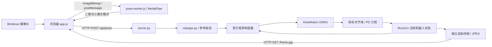

# HoloMotion 摄像头项目：逐步学习指南

这份指南对应当前电脑 `/home/lk/projects/HoloMotion/webcam_teleop` 的实际代码。先学习这个摄像头模块，再沿调用关系进入官方 HoloMotion；不必一开始读完整个仓库。

## 第一步：先分清程序在哪里运行

| 程序 | 运行位置 | 负责的事 |
|---|---|---|
| VS Code | Windows，连接 WSL | 编辑代码、启动终端任务 |
| 浏览器页面 | Windows | 获取摄像头、识别人、显示机器人 |
| MediaPipe Worker | 浏览器独立线程 | 将每帧图像转换成人体关键点 |
| server.py | WSL Ubuntu 的 Python 环境 | HTTP 接口、模型推理、机器人仿真 |
| HoloMotion ONNX | WSL，通过 ONNX Runtime 调用 NVIDIA GPU | 根据机器人现状和参考目标输出动作 |
| MuJoCo | WSL | 根据力矩计算机器人下一刻的状态 |

VS Code 是编辑器。页面是操作界面。Python 服务运行模型和仿真。关闭页面通常不会结束 Python 服务。



练习：不看图，说明“网页在哪里，模型在哪里，谁在计算物理”。

## 第二步：跟着启动顺序读代码

在 Ubuntu 终端运行：

```bash
bash ~/start-webcam-holomotion.sh
```

当前电脑的脚本顺序是：

1. `start-webcam-holomotion.sh` 调用 `start-holomotion.sh`。
2. 后者加载 Conda、激活 `holomotion_train`，进入 HoloMotion 根目录。
3. 前者设置 `MUJOCO_GL=osmesa`，让 MuJoCo 在后台生成画面。
4. 检查 8765 端口是否已有服务；有则提示，不重复启动。
5. 使用明确的环境解释器执行 `webcam_teleop/server.py`。

`server.py` 最下面的入口相当于：

```python
# 后台开始加载模型并运行控制循环。
threading.Thread(target=simulation_loop, daemon=True).start()
# 主线程接收网页请求；只监听本机。
ThreadingHTTPServer(('127.0.0.1', args.port), Handler).serve_forever()
```

注意：服务器先能响应 HTTP，模型随后才加载完，因此页面能打开不代表模型已就绪。页面通过 `/api/status` 的 `ready` 判断。

加载模型在 `make_evaluator()` 中完成：读取官方配置 → 加载 G1 XML → 加载 ONNX → 创建观测构造器 → 建立站姿参考。最初读取演示 NPZ 是为了初始化官方 motion_tracking 路径，之后参考数组会被实时目标覆盖；跟随时没有播放那段行走动作。

练习：打开 `server.py`，找出入口、`simulation_loop()`、`make_evaluator()` 三处，然后按调用顺序读。

## 第三步：网页如何得到人体关键点

阅读 `web/app.js` 的 `startCamera()`：用户点击按钮后，`getUserMedia()` 请求摄像头，图像显示到 `<video>`。`audio:false` 表示不采集声音。

主线程约每 50 毫秒检查一次视频，将 `ImageBitmap` 发给 Worker：

```javascript
worker.postMessage(
  {type:'frame', bitmap, timestamp:performance.now()},
  [bitmap] // 将图像对象交给 Worker
);
```

`web/pose-worker.js` 负责加载本地 MediaPipe/WASM 和人体识别模型，调用 `detectForVideo()`。当前识别 delegate 为 CPU，与后端 HoloMotion 的 GPU 是两回事。

Worker 返回两种结果：

| 字段 | 大致内容 | 用处 |
|---|---|---|
| `landmarks` | 33 个图像坐标点，x/y 为归一化图像坐标 | 在视频上画骨架 |
| `world` | 33 个估计的三维关键点及可见度 | 发送给后端计算动作 |

三维关键点是单目模型估计，不能当作摄像头测得的精确房间绝对坐标。当前代码主要用关键点之间的方向，降低身材、位置和尺度变化的影响。

`busy` 防止识别任务堆积，`serverBusy` 防止多个关键点上传同时在途。约 20 Hz 是提交上限，实际识别速度取决于电脑。浏览器识别与后端控制频率不必相同；控制线程使用最近一帧有效人体数据。

练习：区分 `landmarks` 和 `world`，说明为什么截图上的二维骨架不是直接输入机器人模型的内容。

## 第四步：模块之间怎么通信

浏览器主线程与 Worker 使用 `postMessage`；浏览器与 WSL 服务使用 HTTP；Python 内部直接调用函数，并用共享状态和线程锁传递数据。当前没有使用 WebSocket、ROS 或消息队列。

| 请求 | 请求内容/返回值 | 作用 |
|---|---|---|
| `POST /api/pose` | `sequence` 和 `landmarks` | 更新最新人体数据 |
| `POST /api/control` | `{"action":"calibrate"}` 等 | 开始、暂停、校准、复位 |
| `GET /api/status` | JSON 状态 | 页面显示就绪、错误、频率等 |
| `GET /frame.jpg?t=...` | JPEG 图片 | 显示后端机器人画面 |
| `GET /` | HTML、JS 等静态文件 | 加载操作页面 |

人体数据示意（真实请求必须有 33 行，下面只展示两行以说明格式）：

```json
{
  "sequence": 42,
  "landmarks": [
    [0.01, -0.45, -0.12, 0.99],
    [0.02, -0.44, -0.13, 0.98]
  ]
}
```

每行依次为 `[x, y, z, visibility]`。`sequence` 是递增帧号，不是时间。后端拒绝重复/更旧帧，并检查形状 `(33,4)` 与有限数值。新摄像头连接通过 `new_camera` 重置序号和校准状态。

后端使用收到请求时的 `time.monotonic()` 记录 `last_pose`，避免混用浏览器和 Python 两套时钟。`STATE['pose']` 只保留最近一帧，不把所有动作排成越来越长的队列。

按钮命令包括：`new_camera`、`calibrate`、`start`、`pause`、`reset`。HTTP 线程设置请求，仿真线程处理校准/复位；HTTP 成功不等于校准一定成功，还要看后续状态。

练习：在浏览器按 F12，选择“网络”，点击“校准站姿”，找到 `/api/control` 的请求内容。

## 第五步：人体怎么变成机器人参考动作

阅读 `retarget.py` 的 `WebcamRetarget`。

1. **检查数据**：肩 11/12、肘 13/14、腕 15/16、髋 23/24 的可见度至少为 0.5；左右按人体自身定义。
2. **校准坐标轴**：由髋到肩的方向估计“上”，由双肩估计“左”，叉乘求“前”，建立正交基 `basis`。`@ basis.T` 将人体向量投影到校准后的方向。
3. **取手臂方向**：肩→肘为上臂，肘→腕为前臂，先归一化，再乘机器人自己的臂长，得到机器人肘和腕的目标位置。
4. **IK 求关节角**：反向运动学从“想让手腕到哪里”反求肩/肘角度。每只手臂只调整肩 pitch/roll/yaw 和肘共 4 个角；腕参考保持默认。
5. **限制和平滑**：每次迭代限幅、遵守关节范围；最后用 0.3 系数平滑，限制参考变化率为 2.5 rad/s。腰部小幅倾斜限制约 ±0.18 rad。
6. **FK 求刚体状态**：正向运动学从关节角求各刚体位置和朝向，交给 HoloMotion 当参考。

IK 核心公式：

```python
# j 是 6×4 雅可比：4 个角的小变化，对肘/腕 6 个位置量有什么影响。
# residual 是“目标位置减当前位置”；阻尼让奇异姿态附近求解更稳定。
delta = np.linalg.solve(j.T @ j + .004 * np.eye(4), j.T @ residual)
```

输出结构：

| 变量 | 形状 | 含义 |
|---|---|---|
| `q` | `(29,)` | 机器人 29 个参考关节角，单位 rad |
| `pos` | `(30,3)` | 30 个参考刚体的三维位置 |
| `quat` | `(30,4)` | 30 个刚体的参考旋转，顺序 xyzw |
| `basis` | `(3,3)` | 校准得到的前、左、上方向基 |

MuJoCo 的旋转排列为 **wxyz**，参考接口为 **xyzw**，源码中的 `[:, [1,2,3,0]]` 正是在转换排列。

`retarget.py` 自己的 `MjData` 用于参考 FK；官方评估器的 `ev.d` 保存受力矩驱动的实际机器人状态。修改前者不会让后者直接瞬移。根部和腿部“参考保持站姿”，也不代表实际物理腿部被锁死。

练习：指出 `fk()` 与 IK 循环的差别，并找到代码里关节角限幅和速度限幅各在哪一行。

## 第六步：模型真正的输入输出

人体的 `(33,4)` 数组先经过上述转换；它不是 HoloMotion ONNX 的直接输入。官方 `PolicyObsBuilder` 将机器人实际状态与参考目标组合成观测。

当前模型输入，依据已运行日志与导出配置：

| 名称 | 形状 | 类型/意义 |
|---|---|---|
| `obs` | `(1,1378)` | float32，一台机器人的观测向量 |
| `past_key_values` | `(1,2,1,32,4,64)` | float32，模型历史注意力缓存 |
| `step_idx` | `(1,)` | int64，当前推理位置索引 |

缓存内部各轴的语义应继续结合导出网络代码分析；不能单凭形状猜每个数字代表什么。当前评估器会按有效上下文长度对步号取模，并把新缓存反馈给下一次推理。

1378 维观测按当前配置的 term-major 顺序拼接：

| 项目 | 维数 | 理解方式 |
|---|---:|---|
| 重力方向投影 | 3 | 机器人朝向与倾斜 |
| 根部角速度 | 3 | 机器人转动有多快 |
| 关节位置反馈 | 29 | 相对默认角度的关节位置 |
| 关节速度反馈 | 29 | 当前关节转动速度 |
| 上一动作 | 29 | 上一次策略输出 |
| 参考根部高度 | 1 | 期望站姿高度 |
| 刚体掩码 | 14 | 哪些参考刚体参与目标 |
| 时间有效标记 | 5 | 五个未来时刻参考是否有效 |
| 目标位置 | 5×14×3 = 210 | 经官方坐标变换的未来目标 |
| 位置误差 | 210 | 参考与机器人之间的位置差 |
| 目标旋转 6D | 5×14×6 = 420 | 旋转的连续 6D 表示 |
| 旋转误差 6D | 420 | 参考与实际旋转关系 |
| 时间偏移 | 5 | 五个参考时刻的偏移信息 |
| **合计** | **1378** | 当前模型契约，不可随意更换顺序 |

对应源码：`holomotion/src/evaluation/obs/obs_builder.py`、`mujoco_link_adapter.py`、`holomotion/src/motion_tracking/link_actor_packing.py`。配置选取 14 个机器人刚体、未来偏移 1~5；参考 FK 的 30 个刚体会进一步按名称选取。网页画的五个绿色点仅是显示选择，不能据此认为模型只看五个点。

“6D 旋转”描述旋转表示，不是 6 个机器人关节。本文不把它等同于欧拉角或四元数。

当前模型输出动作 `actions`：一个 batch 中包含 **29 个归一化动作值**，后端展平成 `(29,)`；另有 `present_key_values` 供下一步使用。动作不是 RGB 图像，也不是直接的关节力矩。

官方 `_update_policy()` 将动作转成目标角度：

```python
target_q = actions * action_scale + default_angles
```

之后按关节名称/映射重排到 MuJoCo 顺序。`action_scale`、默认角、kp/kd 都应读取对应模型元数据，不能随便套另一台机器人的值。

由于实时摄像头无法知道未来，当前原型重复保持最新目标，填满未来参考槽；参考速度设为零，并没有预测未来动作。这是快速动作跟随可能较差的原因之一。

练习：用一句话说出模型为什么既要“参考目标”，又要“机器人当前状态”。

## 第七步：动作如何变成真实的仿真运动

`server.py` 的 `policy_step()` 调用官方 `_update_policy()` 和 `_apply_control()`。

```python
# 当前实现目标角速度为 0，前馈力矩为 0。
tau = kp * (target_q - current_q) - kd * current_dq
# 限制在执行器力矩范围后，交给物理引擎。
data.ctrl[...] = tau
mujoco.mj_step(model, data)
```

P 项用角度误差把关节拉向目标；D 项按当前转速提供阻尼。MuJoCo 再计算惯性、重力、接触等作用下的下一状态。

区分三层量：人体映射的参考关节角 → 模型输出对应的 PD 目标角 → MuJoCo 实际关节角。它们通常不同，实际机器人有惯性、误差和延迟。

控制目标约 50 Hz，每周期预算 20 ms；每次官方控制会执行 `control_decimation` 个物理子步，所以物理步频与模型调用频率不同。渲染单独约 12 Hz，不要求每次控制都生成一张图片。

页面的 `inference_ms` 名称容易误解：源码实际统计的是 `policy_step()`，含观测、模型推理与物理推进，不是纯 ONNX 耗时。

## 第八步：保护和暂停逻辑

- 没有完成校准，不能开始跟随。
- 关键点不可见/不合法：该轮不推进物理仿真。
- 超过 0.5 秒没有有效新帧：冻结物理推进；数据恢复后，仍处于 armed/running 状态时可以继续。
- 点击暂停：将 running 设为 false，需要再次点开始。
- 骨盆高度低于 0.45 m：简单判定跌倒，停止跟随，需要复位和重新校准。
- 页面退出：尝试发暂停通知并关闭摄像头，后端还有过期保护。

这些是本地仿真原型的保护，不应当当作真实机器人安全控制方案。

## 建议按四次学习完成

1. **第一次：启动与页面。** 读启动脚本、server.py 入口、app.js 的 startCamera。亲自启动/停止一次服务。
2. **第二次：通信。** 在浏览器网络面板观察 pose、control、status、frame 四种请求，记下一个真实请求的字段（不必公开个人数据）。
3. **第三次：动作映射。** 读 validate → calibrate → update → fk，解释人体方向如何变成机器人角度。
4. **第四次：模型与物理。** 读官方 _update_policy、PolicyObsBuilder、_apply_control，理解输入观测、模型动作和力矩三者的区别。

可以向导师这样概述：“我用浏览器的 MediaPipe 将摄像头图像转成关键点，通过本地 HTTP 发送给 WSL。后端把人体方向映射成 G1 参考姿态，与机器人状态拼成 1378 维观测，输入 HoloMotion ONNX。策略输出 29 个动作，经过缩放得到目标角，再由 PD 力矩驱动 MuJoCo。当前验证范围是站立上肢跟随。”

这份概述应在你亲自跟着代码走过后，用自己的话讲出来。
